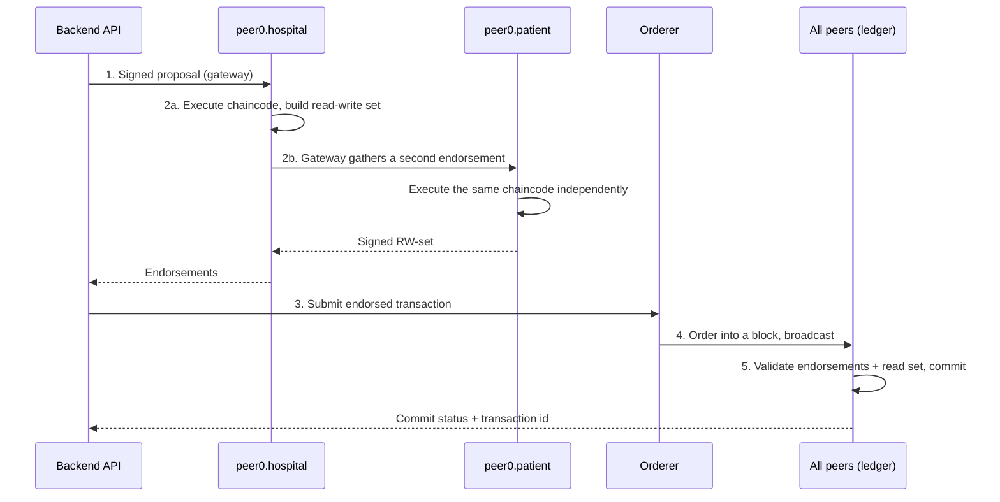

# MedLink — How the Pieces Talk to Each Other

A technical walkthrough of the interactions between the web portal, the mobile
app, the backend API, PostgreSQL and the Hyperledger Fabric network.

This document explains *connections and message flow*. For features see
[../README.md](../README.md); for the blockchain network itself — chaincode,
endorsement policy, operations — see
[../fabric-network/README.md](../fabric-network/README.md).

---

## 1. The one idea that explains everything else

MedLink is **not** "a blockchain database". It is a conventional three-tier
application with a permissioned ledger bolted alongside it, and data sits in one
of **three tiers of trust**. Almost every question about how the system behaves
resolves to "which tier is this in?".

| Tier | Where the truth lives | Who enforces it | Examples |
|---|---|---|---|
| **1 — On-chain state** | Fabric world state | The chaincode, under a 2-of-3 endorsement policy | Patient consent grants |
| **2 — Anchored** | PostgreSQL, with a SHA-256 hash written on-chain | PostgreSQL; the ledger only *witnesses* | Clinical record hashes, emergency overrides, cross-institution grants |
| **3 — Off-chain** | PostgreSQL only | PostgreSQL | Access *requests*, visits, prescriptions, staff accounts, sessions |

Two consequences worth internalising:

- **Consent is enforced by the blockchain.** `checkPermission` genuinely reads
  ledger state. Nobody can grant themselves access by editing a database row.
- **Cross-institution access is only witnessed by it.** Reading away-records is
  authorised by a PostgreSQL query. The ledger holds a hash proving the grant
  was not altered after the fact — it does not authorise the read.

Stating this precisely matters. "Every access is on the blockchain" would be
an overstatement of what the system does.

---

## 2. Component map

```
   ┌──────────────┐        ┌──────────────┐
   │ Web portal   │        │ Mobile app   │
   │ Next.js      │        │ Expo / RN    │
   │ :3001        │        │ (device)     │
   └──────┬───────┘        └──────┬───────┘
          │  HTTPS/REST + SSE      │  HTTPS/REST
          │  Bearer JWT            │  Bearer JWT
          └───────────┬────────────┘
                      ▼
            ┌───────────────────────┐
            │  Backend API          │
            │  Hono on Bun  :3000   │
            │  + Python/ReportLab   │
            └────┬─────────────┬────┘
                 │             │
        Drizzle  │             │  @hyperledger/fabric-gateway
        (TCP     │             │  (gRPC over TLS)
         5432)   ▼             ▼
        ┌────────────────┐   ┌──────────────────────────────┐
        │ PostgreSQL     │   │ Fabric network               │
        │ clinical data  │   │ orderer :7050                │
        │ (encrypted)    │   │ peer0.hospital     :7051     │
        └────────────────┘   │ peer0.practitioner :9051     │
                             │ peer0.patient      :11051    │
                             │ CA (patient org)   :7054     │
                             └──────────────────────────────┘
                                        ▲
                             ┌──────────┴───────────┐
                             │ Blockchain Explorer  │
                             │ :8080 (read-only)    │
                             └──────────────────────┘
```

The frontends **never** talk to Fabric. They have no identity, no certificates
and no gRPC client. Every blockchain interaction is mediated by the backend,
which is the only component holding signing keys.

---

## 3. Frontend → Backend

### How a request is authenticated

The web client is an axios instance whose `baseURL` is `NEXT_PUBLIC_API_URL`,
with two interceptors:

- **Request** — reads `hc_token` from `localStorage` and sets
  `Authorization: Bearer <token>`.
- **Response** — on `401`, clears `hc_token` and `hc_user` and bounces to login.

The mobile app does the same thing against a `BASE_URL` pointing at the
machine's LAN address (a device cannot resolve `localhost`).

### Login is a two-step handshake

```
POST /api/auth/login/staff      → credentials verified, OTP emailed (Resend)
POST /api/auth/verify-otp       → returns { token, user }
```

Patients log in via `/api/auth/login/patient` without the OTP step, because the
mobile app is a second factor in itself.

### The token is stateful, which is unusual and deliberate

`authMiddleware` does **two** checks, not one:

1. Verify the JWT signature with `JWT_SECRET`.
2. Look up a row in `auth_sessions` matching that exact token string, the same
   `userId`, `isActive = true`, and `expiresAt` in the future.

A valid signature alone is not enough. This makes tokens **revocable** — logout
flips `isActive`, and the token dies immediately, which a stateless JWT cannot
do. The cost is a database round-trip on every authenticated request.

On success the middleware attaches to the request context:

```
userId · userType · blockchainAddress · institutionId · sessionId
```

`institutionId` is the basis of nearly all scoping — `null` means super admin.
`blockchainAddress` is what later gets passed to the chaincode.

### Real-time updates

Notifications use **Server-Sent Events** at
`GET /api/notifications/stream`, not WebSockets. Because the browser's
`EventSource` cannot set headers, the middleware accepts the token as a
`?token=` query parameter as a documented fallback.

This is why the Caddy reverse-proxy config disables buffering (`flush_interval -1`)
on that one route — a buffering proxy would hold events until the connection
closed, and the feature would appear silently broken.

---

## 4. Backend → PostgreSQL

All access goes through Drizzle; no raw connection strings in route handlers,
and schema changes are applied as migrations rather than ad-hoc SQL.

Personally identifying and clinical fields are **encrypted at rest** with
AES-256-GCM before insertion, so a database dump alone yields ciphertext. Note
the practical consequence in the code: because names are encrypted, you cannot
`WHERE firstName = ...`. Several routes therefore fetch rows and decrypt in
application code — which is why patient lookup is by national ID hash,
blockchain address or QR code rather than by name search.

---

## 5. Backend → Fabric

This is the part most worth understanding in detail.

### Two independent choices per call

The backend holds **three identities**, one per organisation, loaded from
`FABRIC_NETWORK_PATH`. Every ledger call independently picks:

- **Which identity signs** the transaction
- **Which peer** it is sent through

They are not the same decision. Consent grants use a `PatientOrgMSP` identity —
because the chaincode enforces that only a patient may grant consent — but are
submitted through the **hospital** peer, which is the one reliably online. That
keeps consent patient-sovereign without making it depend on the patient
organisation's peer being up.

### Two handshakes, often confused

**Transport — TLS to the peer.** The gRPC client is constructed with the peer's
TLS CA certificate and `grpc.ssl_target_name_override` set to the peer's
hostname. That override matters because the certificates carry
`peer0.hospital.healthcare.com` in their SANs, so the presented name must match
even when dialling a container IP. This authenticates *the peer to the backend*
and encrypts the channel. It says nothing about who the caller is.

**Application — MSP identity.** Who the caller is comes from the X.509
certificate and private key attached to the gateway connection. Every proposal
is signed with that key, and each peer validates it against the channel's MSP
configuration before executing anything. This is the layer the chaincode sees
through `ctx.clientIdentity.getMSPID()`.

### Write path — full consensus



The endorsement policy is
**`OutOf(2, HospitalOrgMSP, PractitionerOrgMSP, PatientOrgMSP)`** — two of the
three organisations must endorse. No single organisation can forge a consent
grant alone.

In code this is explicit rather than hidden behind a helper:

```
newProposal() → endorse() → submit() → getStatus()
```

The final `getStatus()` yields the real transaction id, which is what gets
stored in `access_permissions.blockchain_transaction_id`.

> **Why determinism is not optional.** Step 2 runs the *same code on different
> machines*. Any non-determinism — `new Date()`, `Math.random()`, iteration over
> an unordered map — produces different read-write sets, the endorsements
> disagree, and the transaction is rejected at step 5 with
> `ENDORSEMENT_POLICY_FAILURE`. This is why all chaincode timestamps come from
> `fabric-network/chaincode/src/txtime.ts`, which reads the timestamp fixed in
> the client's proposal.

### Read path — no consensus

Queries are **evaluates**: they execute on a single peer and return. No
ordering, no block, no commit. That is why they are fast enough to sit inside a
request path.

| Operation | Type | Notes |
|---|---|---|
| `grantPermission` | submit | consensus, 2-of-3 |
| `revokePermission` | submit | consensus |
| `logAccess` | submit | consensus |
| `storeRecordHash` | submit | consensus; writes hash **and** audit entry atomically |
| `checkPermission` | evaluate | single peer |
| `getPatientPermissions` | evaluate | |
| `getPatientAuditLog` | evaluate | |
| `verifyRecordHash` | evaluate | tamper check |
| `getRecordHash` / `getRecordHistory` | evaluate | |
| `getChannelInfo` / `getBlockByNumber` | evaluate | via the system chaincode `qscc` |

### Failure behaviour is asymmetric on purpose

Queries and audit writes are wrapped in a timeout and **fail soft** — a
timeout logs a warning and returns a safe default (`checkPermission` returns
`false`, i.e. fails *closed*). Consent grants **fail hard**: `grantPermission`
propagates its error so the approval is not silently lost.

The reasoning: infrastructure trouble must never block patient care, but it must
also never silently fabricate an authorisation.

---

## 6. Worked example: a doctor reads another hospital's records

This single journey touches all three tiers.

**1. The doctor requests access** — `POST /api/permissions/requests`
Inserts a row into `access_requests` and pushes a notification. **No ledger
call.** A pending request is application state; only a decision is worth
recording permanently.

**2. The patient approves** — `POST /api/permissions/requests/:id/approve`
Blockchain **first**, then the database:

```
grantPermission(patientAddress, practitionerAddress, "24")   ← consensus write
    ↓ returns real txId
INSERT INTO access_permissions (... blockchain_transaction_id = txId)
```

If the database write fails afterwards, a **compensating `revokePermission`**
runs so the two stores cannot disagree. The request row is only marked
`approved` once both succeed.

**3. The doctor opens the record** — `GET /api/patients/:id/history`
The handler grants access if **either** holds:

- `checkPermission(...)` returns true — blockchain consent, **tier 1**; or
- an active, unexpired row exists in `cross_institution_access` — **tier 2**

The response carries `accessVia` (`patient_consent` / `emergency` / …) so the
interface can show *why* the records opened.

**4. The read is logged** — `logAccess(...)` appends an audit entry on-chain.

---

## 7. Emergency override — the exception

When a clinician invokes an override, `POST /api/permissions/emergency-override`:

1. writes `emergency_access_logs` (reason, expiry, actor)
2. writes `cross_institution_access` rows for every other institution holding
   records for that patient
3. writes an `audit_logs` row flagged `isEmergencyOverride`
4. anchors a SHA-256 hash of the event on-chain via `storeRecordHash`

Note what is and is not true here:

- The **access decision is enforced in PostgreSQL**, not by chaincode.
- The **event is anchored**, so altering the row later is detectable.
- Anchoring is **best-effort** — `storeRecordHash` fails soft, so if the network
  is unreachable the override still proceeds and the anchor is skipped.

The honest claim is therefore: *writes are atomic with their audit entry* —
`storeRecordHash` writes the record hash and its audit row in the **same
chaincode transaction**, so a clinical record cannot exist on-chain without its
audit trail. Reads are audited by convention, not by construction.

---

## 8. What each failure looks like

| Failure | Effect |
|---|---|
| Fabric peers down | Logins, visits, prescriptions keep working. Consent approvals and overrides fail loudly. `checkPermission` returns `false`, so away-records stay closed. |
| PostgreSQL down | The API is effectively down; the auth middleware returns `503` because it cannot validate the session. |
| Fewer than 2 orgs endorsing | Every write fails with `no combination of peers can be derived which satisfy the endorsement policy`. |
| Anchor call times out | The clinical action succeeds; the on-chain hash is skipped and logged. |

---

## 9. Where to look in the code

| Concern | File |
|---|---|
| Every Fabric call, identities, timeouts | `backend/src/services/fabric.ts` |
| Token + session validation, request context | `backend/src/middleware/auth.ts` |
| Consent request / approve / revoke / override | `backend/src/routes/permissions.ts` |
| Record access and the two-tier permission check | `backend/src/routes/patients.ts` |
| Cross-institution grants and emergency access | `backend/src/services/cross-institution.ts` |
| Consent contract | `fabric-network/chaincode/src/accessControl.ts` |
| Record hashing + inline audit | `fabric-network/chaincode/src/record.ts` |
| Deterministic transaction time | `fabric-network/chaincode/src/txtime.ts` |
| HTTP client, interceptors | `web/lib/api.ts` |

---

## 10. Verifying the claims in this document

The interactions described here are covered by re-runnable scripts. Each is
self-cleaning and safe to point at a development database.

```bash
cd backend
bun run src/scripts/verify-blockchain-consent.ts      # grant → check → revoke, gateway only
bun run src/scripts/verify-approve-request.ts         # the full HTTP approval path
bun run src/scripts/verify-emergency-override.ts      # override → cross-institution → /history
bun run src/scripts/verify-staff-institution-scope.ts # institution scoping is server-enforced
bun run src/scripts/verify-reports.ts                 # every report, every role, JSON + PDF
```
